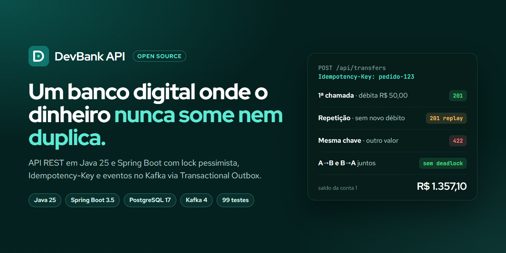
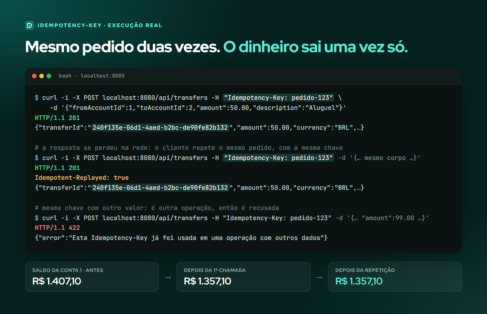
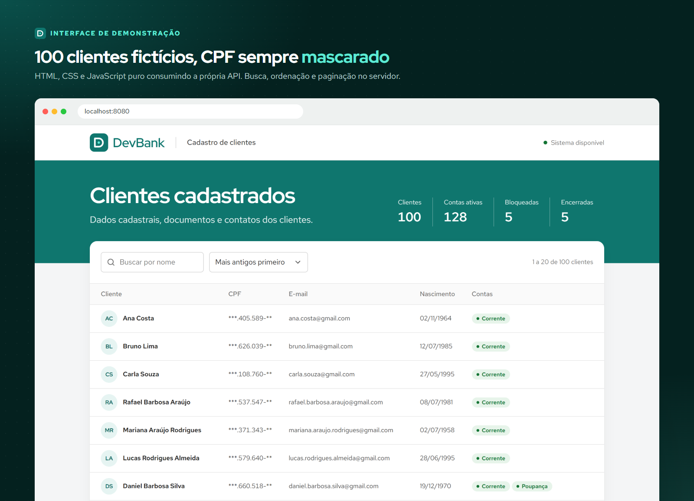
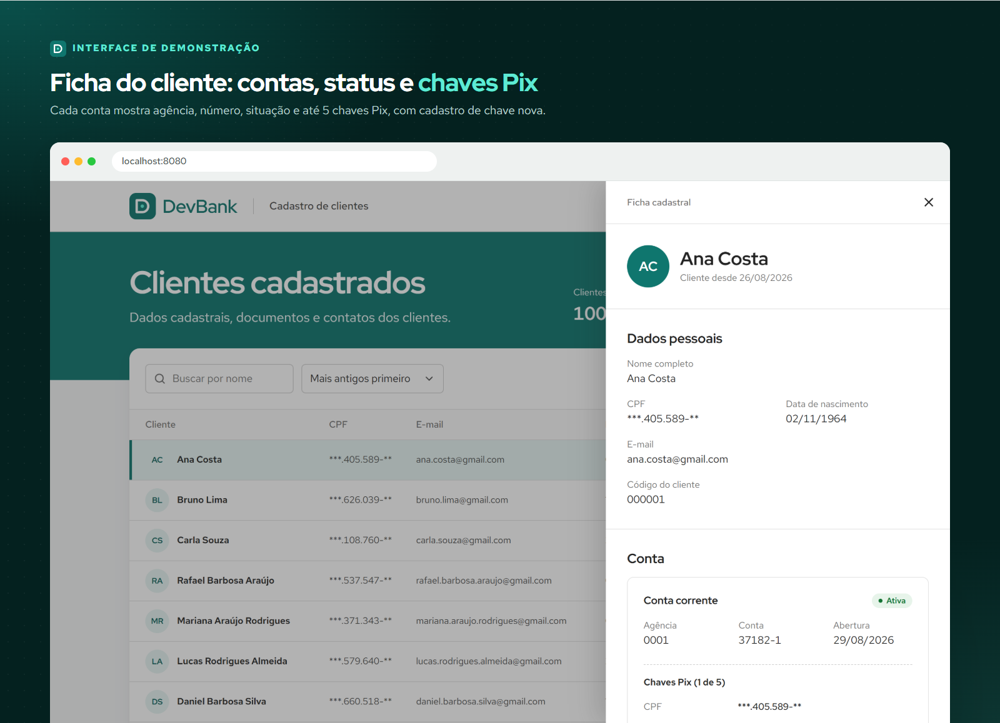
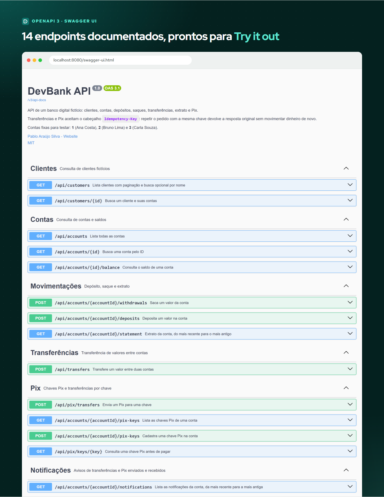
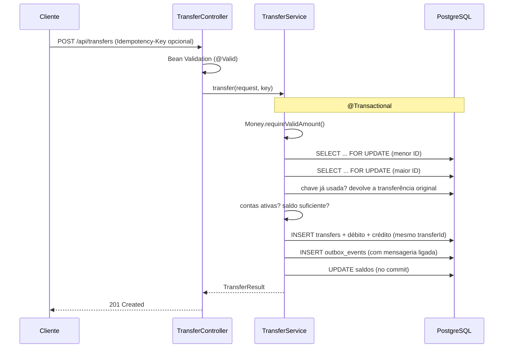
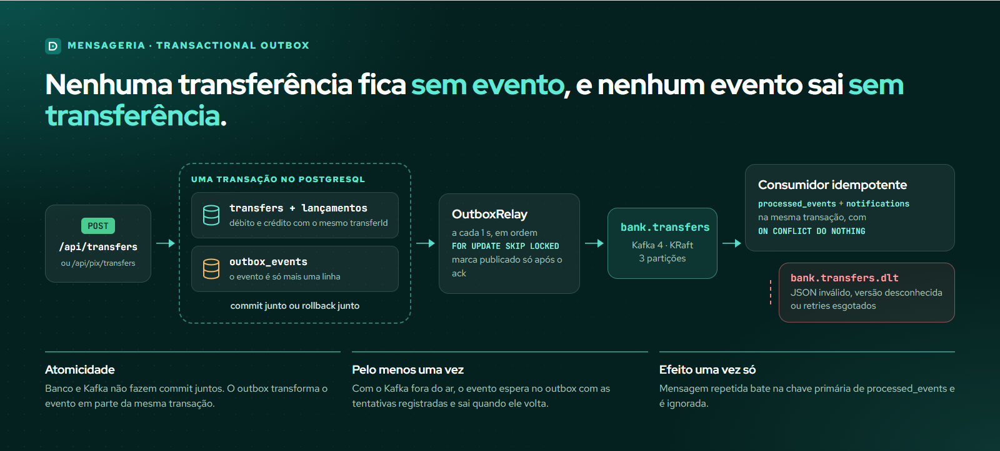
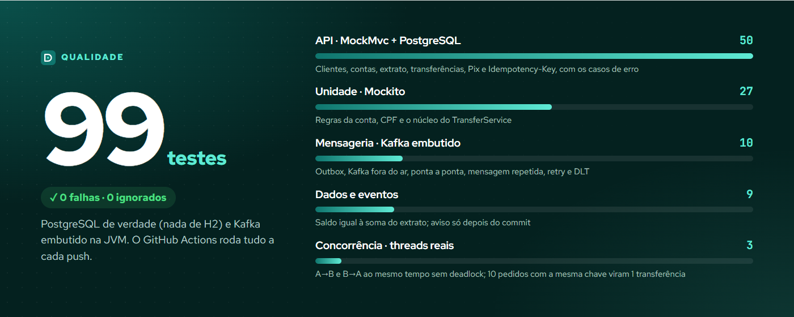

<p align="center">
  
</p>

<p align="center">
  <a href="https://github.com/opablosilvaa21/bank-backend-practice/actions/workflows/ci.yml"></a>
  
  
  
  
  
  <a href="LICENSE"></a>
</p>

<p align="center">
  <a href="#o-que-este-projeto-resolve">O que resolve</a> ·
  <a href="#demonstração">Demonstração</a> ·
  <a href="#como-executar">Como executar</a> ·
  <a href="#arquitetura">Arquitetura</a> ·
  <a href="#mensageria">Mensageria</a> ·
  <a href="#endpoints">Endpoints</a> ·
  <a href="#decisões-técnicas">Decisões</a> ·
  <a href="#testes">Testes</a>
</p>

API REST de um banco digital fictício, feita em **Java 25 e Spring Boot 3.5**: clientes, contas, depósitos,
saques, transferências, extrato e **Pix**.

O CRUD é a parte fácil. O foco aqui é o que torna um back-end bancário difícil: dinheiro que não perde centavos,
saldo que não fica negativo com requisições simultâneas, pedido repetido que não paga duas vezes e eventos que
chegam ao Kafka sem se perder no caminho. Cada uma dessas garantias tem um teste que a prova.

> O DevBank é um banco fictício, feito para estudo. Todos os dados são gerados automaticamente e não
> correspondem a pessoas reais.

<details>
<summary><b>English summary</b></summary>

DevBank is a fictional digital bank REST API built with Java 25 and Spring Boot 3.5. Beyond CRUD, it focuses on
the hard parts of money-moving systems: `BigDecimal` amounts that are rejected instead of silently rounded,
pessimistic locking in a fixed order so concurrent transfers never overdraw or deadlock, an `Idempotency-Key`
header so retried requests never pay twice, and a Transactional Outbox that publishes every transfer to Kafka,
consumed by an idempotent consumer with a dead letter topic. 99 tests run against a real PostgreSQL and an
embedded Kafka on every push.

</details>

## O que este projeto resolve

| Problema | Como foi resolvido | Prova |
|---|---|---|
| **Dinheiro em `double` perde centavos** | Valores em `BigDecimal`, sempre positivos e com no máximo 2 casas. Valor inválido é **recusado** com HTTP 400, nunca arredondado. | [`Money.java`](src/main/java/dev/practice/bank/shared/Money.java) |
| **Duas transferências na mesma conta, ao mesmo tempo** | Lock pessimista (`SELECT ... FOR UPDATE`) nas duas contas, sempre em **ordem crescente de ID**. O saldo nunca fica negativo, e A→B junto com B→A não gera deadlock. | [`TransferConcurrencyTest`](src/test/java/dev/practice/bank/transfer/TransferConcurrencyTest.java) |
| **O cliente repete o pedido** (timeout, clique duplo) | Cabeçalho `Idempotency-Key`: a repetição devolve a resposta original e não movimenta dinheiro de novo, mesmo com as cópias chegando em paralelo. | [`TransferApiIntegrationTest`](src/test/java/dev/practice/bank/transfer/TransferApiIntegrationTest.java) |
| **Banco e Kafka não fazem commit juntos** | **Transactional Outbox**: o evento é gravado na mesma transação da transferência e um relay publica no Kafka. Com o Kafka fora do ar, o evento espera. | [`OutboxKafkaDownIntegrationTest`](src/test/java/dev/practice/bank/messaging/OutboxKafkaDownIntegrationTest.java) |
| **A mesma mensagem chega duas vezes** | Consumidor idempotente: `processed_events` com `ON CONFLICT DO NOTHING` na mesma transação do efeito. Mensagem com defeito vai para a **dead letter topic**. | [`TransferNotificationConsumerIntegrationTest`](src/test/java/dev/practice/bank/notification/TransferNotificationConsumerIntegrationTest.java) |
| **Integridade do extrato** | Cada transferência grava dois lançamentos (débito e crédito) com o mesmo `transferId`. O banco reforça com `CHECK (balance >= 0)`. | [`DemoDataIntegrationTest`](src/test/java/dev/practice/bank/config/DemoDataIntegrationTest.java) |
| **Dados pessoais (LGPD)** | O CPF nunca sai completo pela API (`***.456.789-**`). Os logs registram só IDs e valores, nunca nomes, CPFs ou saldos. | [`Cpf.java`](src/main/java/dev/practice/bank/shared/Cpf.java) |
| **Erros previsíveis** | Um `@RestControllerAdvice` converte exceções em respostas padronizadas (400, 404, 409, 422), sem expor stack traces. | [`ApiExceptionHandler`](src/main/java/dev/practice/bank/api/ApiExceptionHandler.java) |
| **Schema sob controle** | Flyway com migrations SQL; o Hibernate só valida (`ddl-auto=validate`). | [`db/migration`](src/main/resources/db/migration) |

## Demonstração

**Idempotência na prática.** O mesmo pedido enviado duas vezes, com a mesma chave: a segunda resposta é a
original, com `Idempotent-Replayed: true`, e o saldo só cai uma vez.

<p align="center"></p>

**Interface de demonstração.** Uma página em HTML, CSS e JavaScript puro, servida pela própria aplicação, que
consome a API: busca, ordenação, paginação e a ficha de cada cliente com contas e chaves Pix.

<p align="center"></p>

<details>
<summary><b>Mais telas: ficha do cliente e Swagger UI</b></summary>
<br>
<p align="center"></p>
<p align="center"></p>
</details>

## Stack

| Camada | Tecnologia |
|---|---|
| Linguagem | Java 25 |
| Framework | Spring Boot 3.5 (Web, Data JPA, Validation) |
| Banco de dados | PostgreSQL 17, schema versionado com Flyway |
| Mensageria | Apache Kafka 4 (modo KRaft, sem ZooKeeper) com Spring Kafka |
| Documentação | OpenAPI 3 e Swagger UI (springdoc) |
| Testes | JUnit 5, Mockito, MockMvc, Kafka embutido (spring-kafka-test), Awaitility |
| Build e CI | Maven Wrapper, GitHub Actions |
| Interface de demonstração | HTML, CSS e JavaScript puro |

## Como executar

**Pré-requisitos:** JDK 25 e um PostgreSQL 17 na porta 5432. Não é preciso instalar o Maven.

### Com Docker

```bash
git clone https://github.com/opablosilvaa21/bank-backend-practice.git
cd bank-backend-practice
docker compose up -d postgres
./mvnw spring-boot:run
```

No Windows (PowerShell), o último comando é `.\mvnw.cmd spring-boot:run`.

### Com PostgreSQL instalado

No Windows: `winget install PostgreSQL.PostgreSQL.17`. Crie o usuário e o banco uma única vez, entrando como
`postgres`:

```sql
CREATE ROLE bank LOGIN PASSWORD 'bank';
CREATE DATABASE bank OWNER bank;
```

Depois, `./mvnw spring-boot:run`. As tabelas são criadas pelo Flyway ao subir.

| Recurso | Endereço |
|---|---|
| Interface web | http://localhost:8080 |
| Swagger UI | http://localhost:8080/swagger-ui.html |
| PostgreSQL | `localhost:5432`, banco `bank`, usuário `bank`, senha `bank` |

A conexão pode ser trocada pelas variáveis de ambiente `DB_URL`, `DB_USERNAME` e `DB_PASSWORD`.

### Teste rápido

```bash
# Saldo da conta 1
curl http://localhost:8080/api/accounts/1/balance

# Transferência de R$ 250,00 da conta 1 para a conta 2
curl -X POST http://localhost:8080/api/transfers \
  -H "Content-Type: application/json" \
  -d '{"fromAccountId": 1, "toAccountId": 2, "amount": 250.00, "description": "Aluguel"}'
```

<details>
<summary><b>Banco de dados: persistência, recriar a base e acessar pelo terminal</b></summary>
<br>

Os dados ficam salvos no PostgreSQL e continuam lá depois que a aplicação para. A base fictícia só é gerada
quando o banco está vazio.

- Consultar pelo terminal: `psql -h localhost -U bank -d bank` (com Docker: `docker exec -it postgres psql -U bank -d bank`).
- Começar do zero com Docker: `docker compose down -v` (o `-v` apaga o volume).
- Começar do zero no PostgreSQL instalado: `DROP DATABASE bank;` seguido de `CREATE DATABASE bank OWNER bank;`.

</details>

## Arquitetura

O código é organizado **por domínio** (package by feature). Cada pacote reúne seu Controller, Service,
Repository e DTOs:

```
dev.practice.bank
├── account       contas, saldo e status (ATIVA, BLOQUEADA, ENCERRADA)
├── customer      clientes e busca paginada
├── transaction   depósitos, saques e extrato
├── transfer      transferências entre contas, Idempotency-Key e o evento TransferCompleted
├── pix           chaves Pix e envio de Pix
├── notification  avisos de "você enviou / você recebeu" e o consumidor do Kafka
├── messaging     outbox, relay, tópicos e tratamento de erros do Kafka
├── shared        regras comuns: Money, Cpf, exceções base
├── api           tratamento global de erros
└── config        dados fictícios, OpenAPI, CORS e @Async
```

Uma requisição passa por **Controller** (valida a entrada) → **Service** (regras de negócio e transação) →
**Repository** (Spring Data JPA) → **banco**. O Service revalida os dados e não depende só da validação do
Controller, porque também é chamado internamente (o Pix, por exemplo, reaproveita o núcleo da transferência).

### Fluxo de uma transferência



## Mensageria

Toda transferência (TED interna ou Pix) gera o evento `TransferCompleted`. Hoje ele vira as notificações
"Você enviou R$ 50,00 para Bruno Lima por Pix" e "Você recebeu R$ 50,00 de Ana Costa por Pix". Qualquer outro
serviço pode assinar o mesmo tópico depois (antifraude, extrato por e-mail, analytics).

<p align="center"></p>

| Peça | O que garante |
|---|---|
| [`TransferOutboxWriter`](src/main/java/dev/practice/bank/messaging/TransferOutboxWriter.java) | O evento é gravado no outbox **na mesma transação** da transferência. Ou os dois são confirmados, ou nenhum. |
| [`OutboxRelay`](src/main/java/dev/practice/bank/messaging/OutboxRelay.java) | Publica os pendentes em ordem e só marca como publicado depois da confirmação do Kafka. Com o Kafka fora do ar, o evento espera (com as tentativas registradas) e é publicado quando ele voltar. |
| [`TransferNotificationConsumer`](src/main/java/dev/practice/bank/notification/TransferNotificationConsumer.java) | Grava o `eventId` em `processed_events` com `ON CONFLICT DO NOTHING` na mesma transação das notificações: mensagem repetida é ignorada. |
| [`MessagingConfig`](src/main/java/dev/practice/bank/messaging/MessagingConfig.java) | Erro transitório: novas tentativas com intervalo. Mensagem inválida (JSON quebrado, versão desconhecida): direto para a DLT. Esgotou as tentativas: DLT, com o erro nos cabeçalhos. |

A entrega é **pelo menos uma vez** (at-least-once): o relay pode publicar a mesma mensagem duas vezes se cair
entre a confirmação do Kafka e o commit. O consumidor idempotente garante que o **efeito** aconteça uma vez só.

### Dois modos

A mensageria é opcional (`bank.messaging.enabled`), para a aplicação continuar subindo sem Kafka:

| Modo | Caminho do evento |
|---|---|
| Desligada (padrão) | `@TransactionalEventListener(AFTER_COMMIT)` + `@Async` cria as notificações na própria aplicação ([`TransferNotificationListener`](src/main/java/dev/practice/bank/notification/TransferNotificationListener.java)). Simples, mas se a aplicação cair logo após o commit, o aviso se perde. |
| Ligada | Outbox → relay → Kafka → consumidor idempotente, como no diagrama acima. Nada se perde. |

<details>
<summary><b>Rodando com Kafka</b></summary>
<br>

**1. Kafka**, escolha uma opção:

- **Com Docker:** `docker compose up -d` sobe o PostgreSQL e o Kafka 4.4 do [`compose.yaml`](compose.yaml).
- **Kafka instalado** (roda na JVM, sem Docker): baixe o binário em
  [kafka.apache.org/downloads](https://kafka.apache.org/downloads) e extraia. No `config/server.properties`,
  troque o `log.dirs` (o padrão é `/tmp`) e, para o broker ouvir só a sua máquina, use
  `listeners=PLAINTEXT://localhost:9092,CONTROLLER://localhost:9093`. No Windows os scripts ficam em
  `bin\windows\*.bat`:

  ```powershell
  # uma vez só: gera o ID do cluster e formata o armazenamento (modo KRaft)
  $id = .\bin\windows\kafka-storage.bat random-uuid
  .\bin\windows\kafka-storage.bat format --standalone -t $id -c config\server.properties

  # sempre que for usar (Ctrl+C para parar)
  .\bin\windows\kafka-server-start.bat config\server.properties
  ```

**2. Aplicação com a mensageria ligada:**

```powershell
$env:BANK_MESSAGING_ENABLED = "true"
.\mvnw.cmd spring-boot:run
```

Os tópicos são criados ao subir. Para ver as mensagens chegando:

```powershell
.\bin\windows\kafka-console-consumer.bat --bootstrap-server localhost:9092 --topic bank.transfers --from-beginning --property print.key=true
```

No banco, os eventos pendentes no outbox:
`SELECT event_id, attempts, last_error FROM outbox_events WHERE published_at IS NULL;`

</details>

## Endpoints

A documentação completa, com exemplos e o botão "Try it out", está no
[Swagger UI](http://localhost:8080/swagger-ui.html) (com a aplicação rodando).

| Método | Caminho | Descrição |
|---|---|---|
| GET | `/api/customers?name=&page=&size=` | Lista clientes paginados, com busca por nome |
| GET | `/api/customers/{id}` | Cliente e suas contas |
| GET | `/api/accounts` | Lista contas |
| GET | `/api/accounts/{id}` | Busca conta por ID |
| GET | `/api/accounts/{id}/balance` | Consulta saldo |
| POST | `/api/accounts/{id}/deposits` | Depósito |
| POST | `/api/accounts/{id}/withdrawals` | Saque |
| GET | `/api/accounts/{id}/statement?from=&to=&page=&size=` | Extrato, do mais recente ao mais antigo (padrão: últimos 90 dias) |
| POST | `/api/transfers` | Transferência entre contas (aceita `Idempotency-Key`) |
| GET | `/api/accounts/{id}/pix-keys` | Chaves Pix da conta |
| POST | `/api/accounts/{id}/pix-keys` | Cadastra chave Pix (`CPF`, `EMAIL` ou `ALEATORIA`) |
| GET | `/api/pix/keys/{chave}` | Consulta chave: nome do recebedor e CPF mascarado |
| POST | `/api/pix/transfers` | Envia Pix para uma chave (aceita `Idempotency-Key`) |
| GET | `/api/accounts/{id}/notifications?page=&size=` | Avisos de transferências e Pix enviados e recebidos |

Listas paginadas respondem `{"content": [...], "page": {"size", "number", "totalElements", "totalPages"}}`,
com no máximo 100 itens por página. Os erros seguem o formato `{"error": "mensagem"}`; erros de validação
trazem também `"fields": {"campo": "mensagem"}`.

<details>
<summary><b>Exemplo completo: <code>POST /api/transfers</code></b></summary>
<br>

Requisição:

```json
{ "fromAccountId": 1, "toAccountId": 2, "amount": 250.00, "description": "Aluguel" }
```

Resposta `201 Created`:

```json
{
  "transferId": "ba87e5a5-...",
  "channel": "TRANSFERENCIA",
  "fromAccountId": 1,
  "toAccountId": 2,
  "amount": 250.00,
  "currency": "BRL",
  "description": "Aluguel",
  "executedAt": "2026-10-08T13:17:05Z"
}
```

| Status | Quando |
|---|---|
| 201 | Transferência realizada (ou repetida com a mesma Idempotency-Key) |
| 400 | Campo ausente, valor ≤ 0, mais de 2 casas decimais, JSON malformado, origem igual ao destino ou Idempotency-Key inválida |
| 404 | Conta de origem ou de destino não existe |
| 422 | Saldo insuficiente, conta bloqueada ou encerrada, ou Idempotency-Key já usada com outros dados |

O Pix reaproveita o mesmo núcleo da transferência, depois de resolver a conta de destino pela chave.

</details>

### Idempotency-Key: repetir sem pagar duas vezes

Se a resposta se perde (timeout, queda de rede), o cliente não sabe se a transferência aconteceu. Para poder
repetir com segurança, ele envia um cabeçalho `Idempotency-Key` com um valor único por operação (um UUID, por
exemplo). Vale para `POST /api/transfers` e `POST /api/pix/transfers`. O cabeçalho é opcional.

```bash
curl -i -X POST http://localhost:8080/api/transfers \
  -H "Content-Type: application/json" \
  -H "Idempotency-Key: 7f9c1e2a-pedido-1" \
  -d '{"fromAccountId": 1, "toAccountId": 2, "amount": 250.00}'
```

| Situação | Resultado |
|---|---|
| Chave nova | Transfere e responde `201` |
| Mesma chave e mesmos dados | **Não transfere de novo.** Responde `201` com o mesmo corpo da primeira vez e `Idempotent-Replayed: true` |
| Mesma chave com outros dados | `422`: a chave pertence a outra operação |
| Mesma chave chegando em paralelo | Uma executa; as outras esperam o lock das contas e recebem a resposta repetida |

A chave fica na tabela `transfers` (coluna `UNIQUE`), junto com um SHA-256 dos dados do pedido. Ela é conferida
depois do `SELECT ... FOR UPDATE` das contas, e por isso pedidos repetidos em paralelo não passam juntos.

## Regras de negócio

- Valores sempre positivos, com no máximo 2 casas decimais. O sistema nunca arredonda dinheiro.
- O saldo nunca fica negativo.
- Contas `BLOQUEADA` ou `ENCERRADA` não fazem depósito, saque, transferência nem Pix (HTTP 422).
- Uma conta só pode ser encerrada com saldo zero (regra da entidade `Account`).
- A chave Pix do tipo CPF só pode ser o CPF do titular. A chave aleatória é gerada pelo banco.
- Cada conta tem no máximo 5 chaves Pix. Uma chave já cadastrada retorna HTTP 409.
- Toda transferência e todo Pix geram um aviso para quem enviou e outro para quem recebeu. Uma transferência
  desfeita (rollback) ou repetida com a mesma `Idempotency-Key` não gera aviso.

## Decisões técnicas

<details>
<summary><b>Por que lock pessimista e não otimista?</b></summary>
<br>
Em transferências, o conflito é esperado (a mesma conta pode receber e enviar ao mesmo tempo). Com lock otimista
(<code>@Version</code>), o cliente receberia erros e precisaria repetir a operação. O lock pessimista serializa só
as operações que tocam as mesmas contas. Travar sempre na mesma ordem (menor ID primeiro) elimina o risco de
deadlock.
</details>

<details>
<summary><b>Por que recusar em vez de arredondar?</b></summary>
<br>
Se <code>10.005</code> virasse <code>10.01</code> sem aviso, centavos apareceriam ou sumiriam sem registro.
Recusar com HTTP 400 obriga o cliente a enviar o valor exato.
</details>

<details>
<summary><b>Por que o Service revalida o que o Controller já validou?</b></summary>
<br>
A validação do Controller (Bean Validation) protege só a entrada HTTP. O Service é o dono da regra e também é
chamado por outros fluxos, como o Pix.
</details>

<details>
<summary><b>Por que dois lançamentos por transferência?</b></summary>
<br>
É o princípio das partidas dobradas: todo débito tem um crédito correspondente. O <code>transferId</code> em comum
permite auditar e reconciliar as duas pontas.
</details>

<details>
<summary><b>Por que a Idempotency-Key é conferida depois do lock?</b></summary>
<br>
Se fosse antes, duas cópias do mesmo pedido chegando juntas veriam "chave nova" e as duas transfeririam. Depois do
<code>SELECT ... FOR UPDATE</code>, a segunda cópia espera a primeira terminar e já encontra a chave gravada. O
<code>UNIQUE</code> na coluna é a última barreira.
</details>

<details>
<summary><b>Por que outbox e não publicar direto no Kafka?</b></summary>
<br>
Banco e Kafka não fazem commit juntos. Publicar antes do commit pode anunciar uma transferência que sofreu
rollback; publicar depois pode perder o evento se a aplicação cair no meio. Com o outbox, o evento é só mais uma
linha da mesma transação, e o relay cuida do resto.
</details>

<details>
<summary><b>Por que o listener sem Kafka é <code>@Async</code>?</b></summary>
<br>
O <code>AFTER_COMMIT</code> roda antes de a conexão voltar ao pool. Gravar a notificação ali pedia uma segunda
conexão por transferência e, com 10 transferências em paralelo, o pool do Hikari esgotava e tudo travava. O teste
de concorrência pegou isso.
</details>

<details>
<summary><b>Por que não Testcontainers?</b></summary>
<br>
O ambiente de desenvolvimento deste projeto não usa Docker. Os testes rodam num PostgreSQL real (local ou de
serviço no CI) e num Kafka embutido na JVM. Assim nenhum teste depende de um H2 fingindo ser PostgreSQL.
</details>

## Testes

<p align="center"></p>

Os testes usam um PostgreSQL de verdade, no banco `bank_test` (separado do `bank` da aplicação). Crie-o uma vez
com `CREATE DATABASE bank_test OWNER bank;` (com Docker: `docker exec postgres createdb -U bank bank_test`).
Outra conexão pode ser passada por `TEST_DB_URL`.

```bash
./mvnw test
```

Cada contexto de teste apaga o schema, roda as migrations do Flyway e gera a base fictícia de novo
([`TestDatabaseConfig`](src/test/java/dev/practice/bank/TestDatabaseConfig.java)). Os testes de API usam
`@Transactional` e desfazem tudo no fim. Os de concorrência, eventos e mensageria fazem commits de verdade, por
isso cada um roda num schema próprio. Os de mensageria sobem um Kafka dentro da própria JVM
([`@MessagingTest`](src/test/java/dev/practice/bank/messaging/MessagingTest.java)): não é preciso instalar nada.

| Tipo | O que cobre |
|---|---|
| Unidade | Regras da entidade `Account`, validação de CPF e `TransferService` com Mockito (idempotência e evento incluídos) |
| API (MockMvc + PostgreSQL) | Clientes, contas, extrato, transferências, Pix e `Idempotency-Key`, incluindo os casos de erro |
| Dados | A base gerada é coerente (saldo igual à soma do extrato) |
| Concorrência | 20 transferências simultâneas numa conta com R$ 1.500: passam 15 e o saldo termina em zero. 40 transferências cruzadas (A→B e B→A) sem deadlock. 10 pedidos com a mesma chave em paralelo viram uma transferência só |
| Eventos | Notificação só depois do commit; rollback e repetição não geram aviso |
| Mensageria (Kafka embutido) | Outbox na mesma transação, relay publicando, Kafka fora do ar, ponta a ponta, mensagem repetida, JSON inválido, versão desconhecida e erro com retry + DLT |

O GitHub Actions roda a suíte inteira a cada push e em cada pull request, com um PostgreSQL 17 de serviço.

## Dados fictícios

Ao subir, a aplicação gera uma base **100% fictícia**
([`DemoData.java`](src/main/java/dev/practice/bank/config/DemoData.java)):

- 100 clientes: 3 fixos e 97 com nomes aleatórios.
- Contas corrente e poupança em 5 agências, com status `ATIVA`, `BLOQUEADA` ou `ENCERRADA`.
- Extrato com depósito inicial, salário, pagamentos, saques, Pix e rendimento da poupança.
- Chaves Pix: todo cliente tem chave CPF, e alguns também têm e-mail ou chave aleatória.

Os CPFs têm dígitos verificadores válidos, mas são números sorteados. A semente fixa gera sempre a mesma
base. Para mudar, edite o `application.properties`:

```properties
bank.demo.customers=97   # quantidade de clientes gerados (+ 3 fixos = 100)
bank.demo.seed=42        # outra semente gera outra base
bank.demo.enabled=true   # false sobe o banco vazio
```

Como a base só é gerada com o banco vazio, depois de mudar esses valores recrie o banco.

Contas fixas, usadas nos exemplos e nos testes:

| ID | Cliente | Saldo inicial |
|---|---|---|
| 1 | Ana Costa | R$ 1.500,00 |
| 2 | Bruno Lima | R$ 850,00 |
| 3 | Carla Souza | R$ 3.200,00 |

## Roadmap

- [x] Trocar o H2 por PostgreSQL com Docker Compose
- [x] Versionar o schema com Flyway
- [x] Rodar os testes num PostgreSQL real
- [x] Idempotência nas transferências (cabeçalho `Idempotency-Key`)
- [x] Evento `TransferCompleted` com `@TransactionalEventListener`
- [x] Kafka (KRaft) com Transactional Outbox
- [x] Consumidor idempotente com dead letter topic
- [ ] Autenticação com Spring Security e JWT (cada cliente só movimenta as próprias contas)
- [ ] Cadastro de clientes e abertura, bloqueio e encerramento de contas pela API
- [ ] Limpeza dos eventos antigos do outbox e expiração das chaves de idempotência
- [ ] Observabilidade: Spring Boot Actuator, métricas do outbox (pendentes, tentativas) e da DLT

## Autor

**Pablo Araújo Silva**, estudante de Análise e Desenvolvimento de Sistemas.

[LinkedIn](https://www.linkedin.com/in/pablo-araújo-silva) · [GitHub](https://github.com/opablosilvaa21)

Distribuído sob a [licença MIT](LICENSE).
