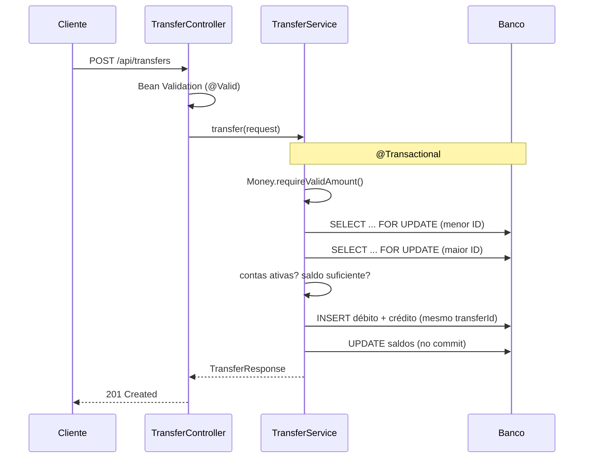

# DevBank API

[](https://github.com/opablosilvaa21/bank-backend-practice/actions/workflows/ci.yml)


API REST de um banco digital fictício, feita em **Java 21 e Spring Boot 3.5**. Ela cobre clientes, contas,
depósitos, saques, transferências, extrato e **Pix**.

O foco do projeto é o que mais importa em um back-end bancário:

- **dinheiro correto**: nada de `double` e nada de arredondamento silencioso;
- **consistência sob concorrência**: o saldo nunca fica negativo, mesmo com transferências simultâneas;
- **proteção de dados pessoais (LGPD)**: o CPF sai mascarado e os logs não carregam dados sensíveis.

> O DevBank é um banco fictício. Todos os dados são gerados automaticamente e não correspondem a pessoas reais.

## Sumário

- [Destaques técnicos](#destaques-técnicos)
- [Stack](#stack)
- [Arquitetura](#arquitetura)
- [Como executar](#como-executar)
- [Endpoints](#endpoints)
- [Regras de negócio](#regras-de-negócio)
- [Decisões técnicas](#decisões-técnicas)
- [Testes](#testes)
- [Dados fictícios](#dados-fictícios)
- [Próximos passos](#próximos-passos)

## Destaques técnicos

| Desafio | Como foi resolvido |
|---|---|
| Precisão monetária | Valores em `BigDecimal`, sempre positivos e com no máximo 2 casas decimais. Valores inválidos são **recusados**, nunca arredondados ([`Money.java`](src/main/java/dev/practice/bank/shared/Money.java)). |
| Concorrência | Cada transferência roda em uma transação e trava as duas contas com **lock pessimista** (`SELECT ... FOR UPDATE`), sempre em **ordem crescente de ID**. A→B e B→A ao mesmo tempo não geram deadlock. |
| Integridade do extrato | Cada transferência grava dois lançamentos (débito e crédito) ligados pelo mesmo `transferId`. O saldo é sempre igual à soma do extrato. |
| Privacidade (LGPD) | O CPF nunca sai completo pela API (`***.456.789-**`). Os logs registram só IDs e valores, nunca nomes, CPFs ou saldos. |
| Erros previsíveis | Um `@RestControllerAdvice` converte exceções em respostas HTTP padronizadas (400, 404, 409, 422) sem expor stack traces. |
| Qualidade | Testes unitários, testes de API, teste de concorrência e CI no GitHub Actions a cada push. |

## Stack

| Camada | Tecnologia |
|---|---|
| Linguagem | Java 21 |
| Framework | Spring Boot 3.5 (Web, Data JPA, Validation) |
| Banco de dados | H2 em memória |
| Documentação | OpenAPI 3 e Swagger UI (springdoc) |
| Testes | JUnit 5, Mockito, MockMvc |
| Build e CI | Maven Wrapper, GitHub Actions |
| Interface de demonstração | HTML, CSS e JavaScript puro |

## Arquitetura

O código é organizado **por domínio** (package by feature). Cada pacote reúne seu Controller, Service,
Repository e DTOs:

```
dev.practice.bank
├── account       contas, saldo e status (ATIVA, BLOQUEADA, ENCERRADA)
├── customer      clientes e busca paginada
├── transaction   depósitos, saques e extrato
├── transfer      transferências entre contas
├── pix           chaves Pix e envio de Pix
├── shared        regras comuns: Money, Cpf, exceções base
├── api           tratamento global de erros
└── config        dados fictícios e CORS
```

Uma requisição passa por **Controller** (valida a entrada) → **Service** (regras de negócio e transação) →
**Repository** (Spring Data JPA) → **banco**. O Service revalida os dados e não depende só da validação do
Controller, porque também é chamado internamente (o Pix, por exemplo, reaproveita o núcleo da transferência).

### Fluxo de uma transferência



## Como executar

**Pré-requisito:** JDK 21. Não é preciso instalar o Maven nem um banco de dados.

```bash
git clone https://github.com/opablosilvaa21/bank-backend-practice.git
cd bank-backend-practice
./mvnw spring-boot:run
```

No Windows (PowerShell), use `.\mvnw.cmd spring-boot:run`.

| Recurso | Endereço |
|---|---|
| Interface web | http://localhost:8080 |
| Swagger UI | http://localhost:8080/swagger-ui.html |
| Console H2 | http://localhost:8080/h2-console (JDBC URL `jdbc:h2:mem:bankdb`, usuário `sa`, sem senha) |

O banco fica em memória e é recriado toda vez que a aplicação sobe.

### Teste rápido

```bash
# Saldo da conta 1
curl http://localhost:8080/api/accounts/1/balance

# Transferência de R$ 250,00 da conta 1 para a conta 2
curl -X POST http://localhost:8080/api/transfers \
  -H "Content-Type: application/json" \
  -d '{"fromAccountId": 1, "toAccountId": 2, "amount": 250.00, "description": "Aluguel"}'
```

## Endpoints

A documentação completa, com exemplos e o botão "Try it out", está no Swagger UI.

### Clientes e contas

| Método | Caminho | Descrição |
|---|---|---|
| GET | `/api/customers?name=&page=&size=` | Lista clientes paginados, com busca por nome |
| GET | `/api/customers/{id}` | Cliente e suas contas |
| GET | `/api/accounts` | Lista contas |
| GET | `/api/accounts/{id}` | Busca conta por ID |
| GET | `/api/accounts/{id}/balance` | Consulta saldo |

### Movimentações

| Método | Caminho | Descrição |
|---|---|---|
| POST | `/api/accounts/{id}/deposits` | Depósito |
| POST | `/api/accounts/{id}/withdrawals` | Saque |
| GET | `/api/accounts/{id}/statement?from=&to=&page=&size=` | Extrato, do mais recente ao mais antigo (padrão: últimos 90 dias) |
| POST | `/api/transfers` | Transferência entre contas |

### Pix

| Método | Caminho | Descrição |
|---|---|---|
| GET | `/api/accounts/{id}/pix-keys` | Chaves Pix da conta |
| POST | `/api/accounts/{id}/pix-keys` | Cadastra chave Pix (`CPF`, `EMAIL` ou `ALEATORIA`) |
| GET | `/api/pix/keys/{chave}` | Consulta chave: nome do recebedor e CPF mascarado |
| POST | `/api/pix/transfers` | Envia Pix para uma chave |

Listas paginadas respondem `{"content": [...], "page": {"size", "number", "totalElements", "totalPages"}}`,
com no máximo 100 itens por página.

### Exemplo: `POST /api/transfers`

Requisição:

```json
{ "fromAccountId": 1, "toAccountId": 2, "amount": 250.00, "description": "Aluguel" }
```

Resposta `201 Created`:

```json
{
  "transferId": "ba87e5a5-...",
  "channel": "TRANSFERENCIA",
  "fromAccountId": 1,
  "toAccountId": 2,
  "amount": 250.00,
  "currency": "BRL",
  "description": "Aluguel",
  "executedAt": "2026-10-08T13:17:05Z"
}
```

| Status | Quando |
|---|---|
| 201 | Transferência realizada |
| 400 | Campo ausente, valor ≤ 0, mais de 2 casas decimais, JSON malformado ou origem igual ao destino |
| 404 | Conta de origem ou de destino não existe |
| 422 | Saldo insuficiente, ou conta de origem ou destino bloqueada ou encerrada |

Os erros seguem o formato `{"error": "mensagem"}`. Erros de validação trazem também
`"fields": {"campo": "mensagem"}`.

O Pix reaproveita o mesmo núcleo da transferência, depois de resolver a conta de destino pela chave.

## Regras de negócio

- Valores sempre positivos, com no máximo 2 casas decimais. O sistema nunca arredonda dinheiro.
- O saldo nunca fica negativo.
- Contas `BLOQUEADA` ou `ENCERRADA` não fazem depósito, saque, transferência nem Pix (HTTP 422).
- Uma conta só pode ser encerrada com saldo zero (regra da entidade `Account`).
- A chave Pix do tipo CPF só pode ser o CPF do titular. A chave aleatória é gerada pelo banco.
- Cada conta tem no máximo 5 chaves Pix. Uma chave já cadastrada retorna HTTP 409.

## Decisões técnicas

**Por que lock pessimista e não otimista?** Em transferências, o conflito é esperado (a mesma conta pode
receber e enviar ao mesmo tempo). Com lock otimista (`@Version`), o cliente receberia erros e precisaria
repetir a operação. O lock pessimista serializa só as operações que tocam as mesmas contas. Travar sempre na
mesma ordem (menor ID primeiro) elimina o risco de deadlock.

**Por que recusar em vez de arredondar?** Se `10.005` virasse `10.01` sem aviso, centavos apareceriam ou
sumiriam sem registro. Recusar com HTTP 400 obriga o cliente a enviar o valor exato.

**Por que o Service revalida o que o Controller já validou?** A validação do Controller (Bean Validation)
protege só a entrada HTTP. O Service é o dono da regra e também é chamado por outros fluxos, como o Pix.

**Por que dois lançamentos por transferência?** É o princípio das partidas dobradas: todo débito tem um
crédito correspondente. O `transferId` em comum permite auditar e reconciliar as duas pontas.

## Testes

```bash
./mvnw test
```

| Tipo | O que cobre |
|---|---|
| Unidade | Regras da entidade `Account`, validação de CPF e `TransferService` com Mockito |
| API (MockMvc + H2) | Clientes, contas, extrato, transferências e Pix, incluindo os casos de erro |
| Dados | A base gerada é coerente (saldo igual à soma do extrato) |
| Concorrência | Transferências simultâneas não deixam saldo negativo nem causam deadlock ([`TransferConcurrencyTest`](src/test/java/dev/practice/bank/transfer/TransferConcurrencyTest.java)) |

O GitHub Actions roda a suíte inteira a cada push e em cada pull request.

## Dados fictícios

Ao subir, a aplicação gera uma base **100% fictícia**
([`DemoData.java`](src/main/java/dev/practice/bank/config/DemoData.java)):

- 100 clientes: 3 fixos e 97 com nomes aleatórios.
- Contas corrente e poupança em 5 agências, com status `ATIVA`, `BLOQUEADA` ou `ENCERRADA`.
- Extrato com depósito inicial, salário, pagamentos, saques, Pix e rendimento da poupança.
- Chaves Pix: todo cliente tem chave CPF, e alguns também têm e-mail ou chave aleatória.

Os CPFs têm dígitos verificadores válidos, mas são números sorteados. A semente fixa gera sempre a mesma
base. Para mudar, edite o `application.properties`:

```properties
bank.demo.customers=97   # quantidade de clientes gerados (+ 3 fixos = 100)
bank.demo.seed=42        # outra semente gera outra base
bank.demo.enabled=true   # false sobe o banco vazio
```

Contas fixas, usadas nos exemplos e nos testes:

| ID | Cliente | Saldo inicial |
|---|---|---|
| 1 | Ana Costa | R$ 1.500,00 |
| 2 | Bruno Lima | R$ 850,00 |
| 3 | Carla Souza | R$ 3.200,00 |

## Próximos passos

- [ ] Trocar o H2 por PostgreSQL com Docker Compose
- [ ] Versionar o schema com Flyway
- [ ] Autenticação com Spring Security e JWT
- [ ] Idempotência nas transferências (cabeçalho `Idempotency-Key`)

## Autor

**Pablo Araújo Silva**, estudante de Análise e Desenvolvimento de Sistemas.

[LinkedIn](https://www.linkedin.com/in/pablo-araújo-silva) · [GitHub](https://github.com/opablosilvaa21)
